<p align="center">
  
</p>

---

## ⚡ At a glance

| | |
|---|---|
| 🎓 **Study** | Diploma of IT @ UTS College → **Bachelor of AI @ UTS** |
| 🏁 **Hackathons** | Qiskit Fall Fest 2026 (3rd) · RIMPA Hackathon 2026 (Top 8) |
| 🧠 **Focus** | AI · building small games & tools |
| 🤝 **Teamwork** | Built and presented projects in hackathon teams under tight deadlines |

## 🚀 Featured project

### 🐦 [Qubird](https://github.com/Percy2234/Qiskit)

> A bird-through-pipes game where **every pipe you pass runs a real quantum circuit** — the result decides whether the bird flips upside down, speeds up, or slows down.

<!-- 🎬 Record a short gameplay GIF, upload it to the repo as qubird-demo.gif, then delete this comment line and the one below -->
<!-- <p align="center"></p> -->

- **Stack:** Python · Qiskit
- **What I did:** game logic + connecting quantum measurement results to in-game effects
- **Built for:** Qiskit Fall Fest 2026 (placed 3rd)
- **Team:** with [@turtletiny](https://github.com/turtletiny)

## 🛠️ Tech stack

<p>
  
</p>

```python
learning_now = ["Machine Learning basics", "SQL & database design", "Networking"]
```


<p align="center"><sub>💬 Always happy to chat about AI, coding, or a project idea.</sub></p>
